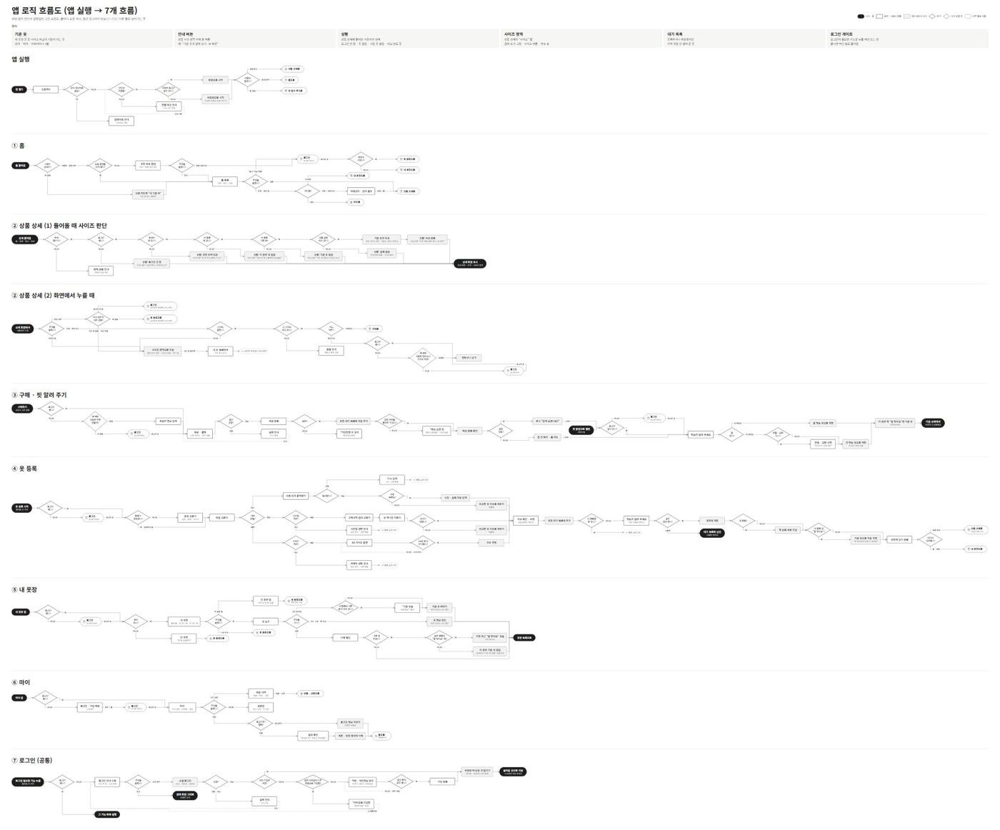
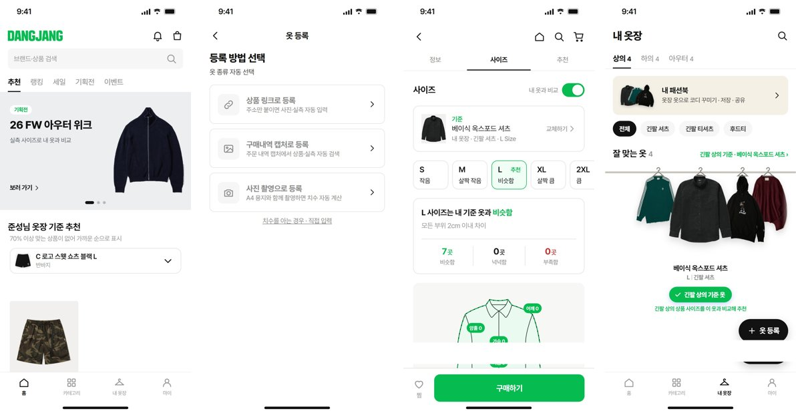
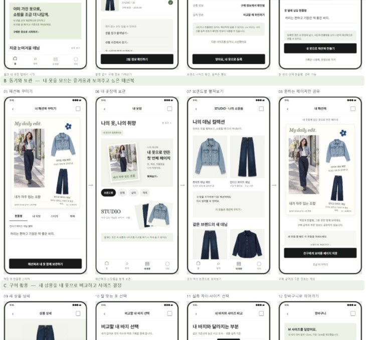
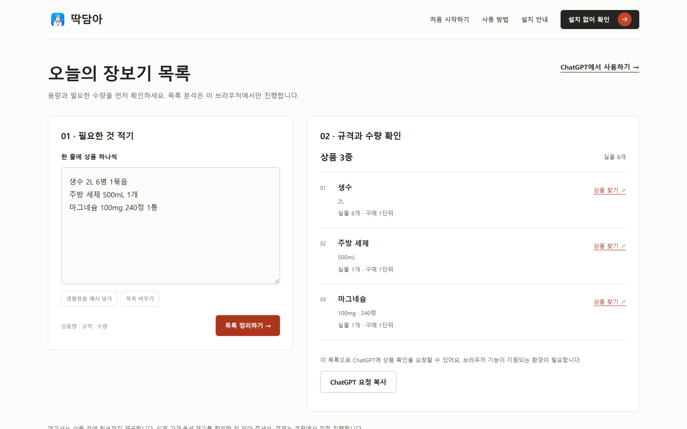

# 박준성 · 서비스 기획 · PM/PO (신입)

개인 게임 브랜드로 웹·모바일 게임을 출시하고, 이용 기록을 보며 서비스를 고쳐 온 신입 서비스 기획자입니다.
무엇을 만들지와 언제 낼지, 결과를 어떤 숫자로 판단할지를 먼저 정하고 움직입니다.

[clunk.games](https://clunk.games/ko/play) · [딱담아 체험](https://ddakdama.artemis-clunk.workers.dev/try) · [DANGJANG 시연](https://dangjang-demo.vercel.app) · [주간 성장 기록](https://app.notion.com/p/f861ebe5850d820e81d0014c3b87b65e)

 

| 149명 · 797판 | 52% | 1,580명 | 62개 |
| --- | --- | --- | --- |
| 웹 게임을 한 판 이상 끝까지 한 사람·판 수 (2026.09.23~10.17) | 첫 화면에 처음 온 방문 125건 중 게임으로 넘어가지 않은 비율 (09.24~28) | 토스 앱 '10초 5원' 포인트 홍보로 모은 사람 (11.03~04, 7,900원) | 팀 앱 화면 흐름도의 확인 지점, 그중 53개를 새로 정의 |

---

## 01 · Clunk Games · 웹 게임 3개 공개, 모바일 게임 3개 출시

개인사업자(아르테미스, 2026.08~)로 운영하는 캐주얼·퍼즐 게임 브랜드입니다. 웹 게임은 가입·설치 없이 링크로 시작해 모든 플레이어가 같은 블록 순서로 주간 순위를 겨룹니다(3개 중 1개는 2026.11에 내려 지금은 2개). 모바일 게임 3개는 Google Play, 토스 앱(앱인토스), 원스토어(웹 게임 상품)에 냈습니다. 게임 규칙과 수익 방식, 출시 시점은 제가 정했습니다.

- **이용 기록 설계** 방문·시작·완료·공유 기록과 날마다 빠지는 비율을 보는 운영자 화면(09.24), 유입 경로 저장(10.29), 토스용 첫 10초 기록(11.03)
- **첫 화면 이탈** 첫 화면에 처음 온 방문 125건 중 52%가 게임으로 넘어가지 않음 → 게임을 바로 열지 않는 버튼 구조를 원인 후보로 보고 게임 직행으로 수정(10.21, 수정 뒤 효과는 측정 전)
- **순위 공정성** 퍼즐은 서버가 입력 기록을 다시 돌려 점수 계산, 탑은 높이 상한과 지난 4주 기록 기준선을 넘는 기록을 순위 반영 전 보류(10.29 위조 기록 29.9m로 보류 확인). 같은 IP의 가입 수는 시간·하루 단위로 제한
- **장애 대응** 서버 무료 읽기 한도 초과로 약 6시간 중단(09.25) → 최고 기록만 따로 모은 표를 읽게 바꾸고 기존 순위 110건이 그대로인지 확인 후 재개. 결제·로그인 장애 원인 2개 수정(10.26)
- **토스 홍보 실험** 7,900원·1,580명, 첫 블록을 쌓은 사람 중 한 판 완료 13~15%, 11.03에 들어온 622명 중 다음 날 재방문 5명 → 중단. 11.09 다른 퍼즐 게임에서 19~29세로 좁혀 재실험(11.10 접속 73명 중 45%가 한 판 완료, 게임이 달라 나이 효과로 단정하지 않음)
- **출시 전 검수** AI 점검에서 나온 버그 후보 58건 중 다시 검증해 확인된 52건만 수정

[웹 게임 하기 →](https://clunk.games/ko/play) · [Clunk Tower (Google Play) →](https://play.google.com/store/apps/details?id=games.clunk.tower) · 소스 저장소는 비공개

---

## 02 · DANGJANG · 패스트캠퍼스 AI 심화캠프 10기 5인 팀 프로젝트

키·몸무게가 같아도 체형 비율이 달라 온라인에서 산 옷이 맞지 않는 일을 막으려고, 이미 잘 맞는 내 옷과 새 옷의 치수를 비교해 주는 앱입니다. 5명이 함께 만들었고, 아래는 제가 맡은 부분입니다.

- **화면 흐름도** 팀 화면 흐름을 확인 지점 단위로 점검해 8구역·확인 지점 62개(53개 새로 정의)로 정리하고, 앱 실행에서 7개 흐름으로 갈라지는 한 장으로 팀 피그마에 공유
- **조사** 인터뷰 질문지 24문항 작성, 팀 인터뷰 5건 분석(반복 패턴 6개), 설문 원자료(유효 23명) 재분석, 배포 전 가상 응답 60명으로 문항 점검
- **옷 등록 기능** 상품 링크·구매 내역 캡처·A4와 함께 찍은 사진·직접 입력 4가지를 치수 확인 화면 하나로 모음. 확신 없는 치수는 숫자 대신 다시 찍기 안내. 합성 사진 64건 시험에서 측정 성공 37건의 평균 오차 0.35cm(실제 옷 시험 전)
- **팀 기획서 맞추기** 팀 기획서와 제 시제품을 43개 항목으로 대조해 다른 27곳을 찾아 고치기 시작, 팀장 요청으로 시제품의 실행 방법과 남은 위험 6가지를 문서로 정리해 넘김
- **신기능 제안** 팀 저장소에 첫 신기능 제안서를 올렸고, 같은 날 같은 형식의 제안서 3건이 이어짐

팀 사용성 테스트(팀 성과, 참가 19명): 같은 티셔츠에서 맞는 사이즈를 고른 사람이 기존 쇼핑몰 화면 17명 중 7명, 우리 앱 화면 14명 중 10명. 최종 발표도 팀 성과입니다. [시연 화면 →](https://dangjang-demo.vercel.app)

---

## 03 · 딱담아 · ChatGPT 장보기 목록을 쿠팡 장바구니로

화장품·생활용품 5종을 쿠팡에서 직접 사며 단계마다 적어 보니, 살 물건을 정한 뒤에도 다시 찾기·용량 비교·개수 계산에 40분 넘게 걸렸습니다(본인 1회 기록). 이 구간을 줄이려고 만든 ChatGPT 앱과 Chrome 확장 프로그램입니다. 사용자가 승인한 상품만 담고 결제와 비밀번호는 다루지 않습니다.

- '100mg 240정 1통'을 240개로 담는 등 목록을 잘못 읽는 오류를 고쳐, 직접 만든 시험용 목록 50줄에서 상품명·용량·함량·묶음·수량이 모두 맞은 비율 64% → 98%
- 캠프 실습 인터뷰 1건에서 예상과 다른 쇼핑 습관을 보고 사용자를 목록 우선형과 검색 우선형으로 나눔
- 5명·2주 사용 테스트는 아직 하지 않았고, 시작 전에 합격선(추천 후보 그대로 선택 70% 이상, 준비 시간 절반 이하, 5명 중 3명 재사용)을 적어 둠

[설치 없이 체험 →](https://ddakdama.artemis-clunk.workers.dev/try) · [저장소 →](https://github.com/Artemis-ignis/ddakdama)

---

## 경력 · 교육

| 기간 | 내용 |
| --- | --- |
| 2026.11 | 패스트캠퍼스 기업교육 'Claude Code로 업무 Agent 만들기' 실습코치 (수강생 실습 보조, 기간제) |
| 2026.08 – 현재 | 아르테미스(Clunk Games) 대표 · 게임 출시·운영 (1인) |
| 2026.08 – 2026.11 | 패스트캠퍼스 AI 심화캠프 10기 (AI Product Manager Bootcamp) |
| 2026.10 | SK하이닉스 AI 해커톤 2026 서류 합격·1차 예선 통과·2차 예선 응시 |
| 2025.12 – 2026.04 | 니혼피트(일본) 현장 사원 · 일본어로 업무 소통 (JPT 450점) |
| 2024.08 – 2024.09 | 엘피케이로보틱스 설계 인턴 |
| 2022.06 – 2023.04 | 메타체인 사업부 · 블록체인 게임 콘텐츠 기획, 시장 조사, 투자 제안서 |
| 2017.03 – 2023.02 | 동양미래대학교 경영정보학과 (전문학사) |

숫자는 괄호 안 날짜에 확인한 값입니다. 합성 시험 수치는 실제 사용자 결과가 아닙니다.
